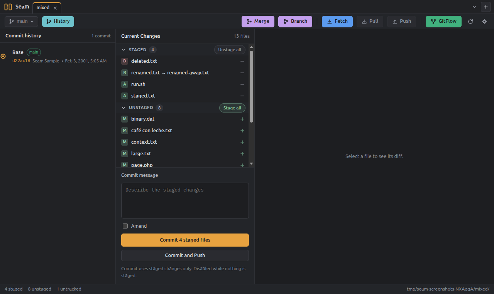
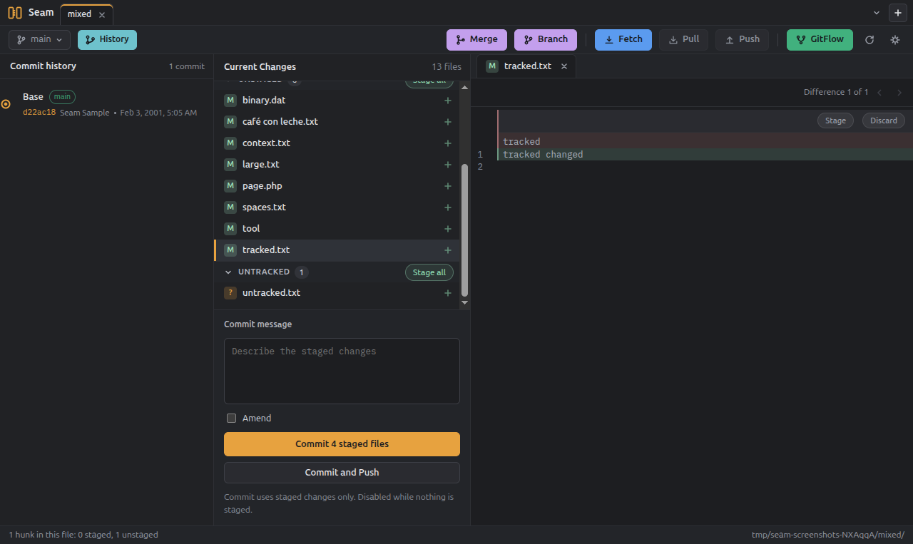
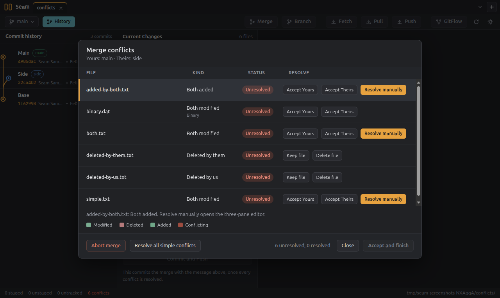
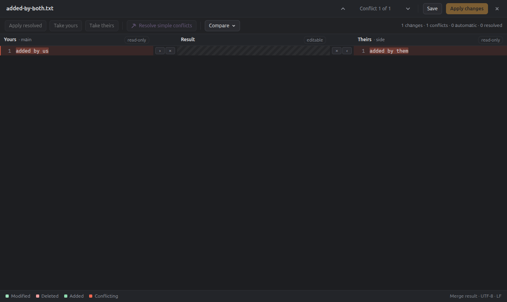

# Seam

Seam is a desktop Git client for Windows and Linux with a graphical interface.
It covers the everyday flow (staging, commits, branches, merges, push and
GitFlow) and adds a dedicated three-pane merge conflict resolver for when a
merge, rebase, cherry-pick or stash pop stops. A diff viewer is built into both.

Seam drives the real `git` executable as a child process instead of
reimplementing it, so hooks, configuration, credential helpers and attributes
behave exactly as they do in the terminal. The three-way merge engine and the
line-level diff are the only parts written from scratch, because Git does not
expose the regions the merge editor needs.

## Screenshots

| Changes                                                                      | Diff                                                                   |
| ---------------------------------------------------------------------------- | ---------------------------------------------------------------------- |
|  |  |

| Conflicts                                                              | Merge editor                                                           |
| ---------------------------------------------------------------------- | ---------------------------------------------------------------------- |
|  |  |

## Install

### Windows

Download `Seam-0.2.0-windows-setup.exe` from the
[latest release](https://github.com/orbeji/seam/releases/latest) and run it. The
installer is per-user and does not need administrator rights.

The 0.2.0 installer is **not code-signed**, so Windows SmartScreen shows an
unknown publisher warning. Choose **More info → Run anyway** only if the
SHA-256 of the download matches the `SHA256SUMS.txt` published with the release.

### Linux

Download the `.deb` or the `.AppImage` from the
[latest release](https://github.com/orbeji/seam/releases/latest).

```bash
# Debian, Ubuntu and derivatives. Git is installed as a dependency.
sudo apt install ./Seam-0.2.0-linux-amd64.deb

# AppImage: make it executable and run it. It may need FUSE 2.
chmod +x Seam-0.2.0-linux-x86_64.AppImage
./Seam-0.2.0-linux-x86_64.AppImage
```

If the AppImage refuses to start because FUSE is missing, install `libfuse2`
(FUSE 2) or use the `.deb`. The `.deb` is the recommended package on Debian and
Ubuntu.

## Requirements

- Git 2.30 or newer on the `PATH`. On Windows, Seam also looks in the usual Git
  for Windows install folders. Missing or older Git shows a help screen with a
  download link instead of failing when a repository is opened. Set
  `SEAM_GIT_PATH` to use a specific executable, such as a portable copy.
- A 64-bit Windows 10/11 or a 64-bit Linux distribution with GTK 3.

Seam does not bundle Git in 0.2.0. See [What Seam 0.2.0 does not do](docs/limitaciones.md)
for this and the other limits of the version.

## Build from source

Node.js 22 or newer is required.

```bash
npm install
npm run dev      # hot reload while developing
npm run build    # type-check and produce out/
npm run pack     # unpacked application in release/
npm run dist     # installers for the current platform
```

`npm run dist:linux` produces the AppImage and `.deb`; `npm run dist:win`
produces the NSIS installer. The configuration is in `electron-builder.yml` and
the icons are in `build/`.

## Scripts

| Command                    | What it does                                           |
| -------------------------- | ------------------------------------------------------ |
| `npm run dev`              | Starts the app with hot reload for all three processes |
| `npm run build`            | Type-checks and builds the production bundles          |
| `npm run start`            | Previews the production build                          |
| `npm run typecheck`        | Runs `tsc --noEmit` for the Node and web projects      |
| `npm run lint`             | Runs ESLint                                            |
| `npm run format`           | Formats with Prettier                                  |
| `npm test`                 | Runs the unit and integration suites once              |
| `npm run test:unit`        | Runs the unit suite (the one CI runs)                  |
| `npm run test:integration` | Runs the suite that drives real `git`                  |
| `npm run test:e2e`         | Builds and runs the Playwright end-to-end suite        |
| `npm run pack`             | Builds an unpacked application in `release/`           |
| `npm run dist`             | Builds the installers for the current platform         |
| `npm run licenses`         | Prints the licence summary of the dependencies         |
| `npm run release:notes`    | Prints the changelog section of the current version    |

The unit suite never starts Git or Electron. Name a test that needs either one
`*.integration.test.ts` or `*.e2e.ts`; those suites run separately. The
integration suite needs Git on the `PATH`; the end-to-end suite launches the
built application and needs a display. Run both locally, under `xvfb-run -a` on
a headless Linux machine.

The package smoke test launches an installer's executable instead of the
development build:

```bash
npm run pack
npm run test:e2e:packaged
# or point it at an installed copy
SEAM_EXECUTABLE=/opt/Seam/seam npm run test:e2e:packaged
```

## Opening a repository

Use **Open repository…** to pick a folder; Seam remembers the ten most recent
ones. From a shell, `seam --repo <path>` opens a repository directly.

## Branches, merges and GitFlow

The top bar groups the branch actions before the remote ones:

- **Branch** creates a local branch from HEAD, another branch or a tag, and
  renames or deletes an existing one. Deleting refuses to throw away unmerged
  commits unless the force box is ticked.
- **Merge** merges a local or remote branch into the checked-out one. The
  strategy is a real merge commit (`--no-ff`), a fast-forward only, or a
  squash that leaves the changes staged for the next commit.
- **GitFlow** is one dynamic popup driven by plain `git`. With no
  configuration it asks for the master, develop and prefix names. On a
  feature, release or hotfix branch it offers the finish for that branch; on
  any other branch it starts a new one. A feature is merged into develop; a
  release or hotfix is merged into master, tagged, merged back into develop and
  deleted.
- **Worktrees** lists every worktree with its pending changes and opens one as
  a tab. It creates a worktree on an existing branch, a new branch or a detached
  HEAD, moves, locks, unlocks, repairs, prunes and removes them, and merges one
  worktree's branch into another branch. Branches checked out in another
  worktree are hidden from the branch menu.

The GitFlow configuration lives in the repository's local Git config, so a
terminal clone keeps working with it. If a finish stops on a conflict, the
remaining steps are stored in `.git/seam/gitflow-finish.json`; resolving the
merge and committing resumes the finish from the popup or on its own.

The commit graph stays beside the file sidebar. Selecting a commit shows its
changed files and their diff; a button in the graph's header makes it fill the
window, and the same button returns to the split.

## Layout

```text
src/
  core/       pure TypeScript, no Electron or DOM (git, diff, merge, text)
  main/       Electron main process
  preload/    typed bridge exposed to the interface
  renderer/   React interface and i18n catalogs
  shared/     IPC types shared by every layer
test/
  fixtures/   scripts that build sample repositories
  *.integration.test.ts  tests that drive real Git
  e2e/        Playwright tests, including the packaged smoke test
build/        packaging icons
docs/         specification, implementation plan, screen designs and limits
scripts/      release helpers
```

The import rules between `core`, `main` and `renderer` are enforced by ESLint.

## Releases

CI runs on every pull request and every push to `main`. Pushing a tag that
matches the version in `package.json` (for example `v0.2.0`) builds the three
installers, runs the end-to-end and packaged smoke tests, computes the SHA-256
checksums and creates a **draft** GitHub Release. A person reviews and
publishes it. The notes come from [CHANGELOG.md](CHANGELOG.md).

## Contributing

See [CONTRIBUTING.md](CONTRIBUTING.md) for the development workflow, the test
layout and how to add a language.

## Licence

[MIT](./LICENSE)
